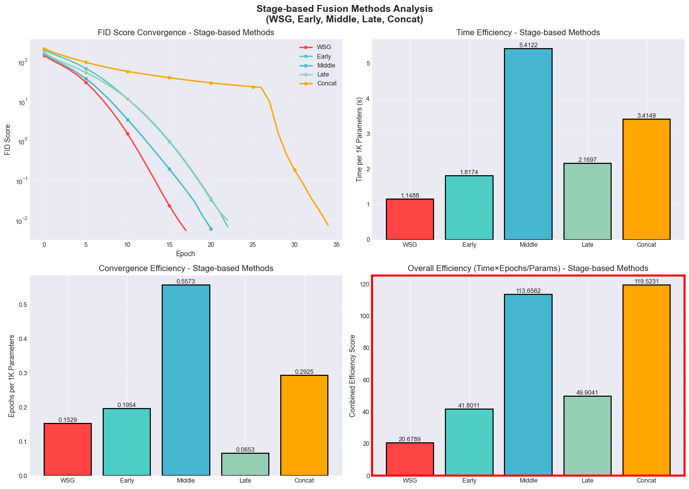
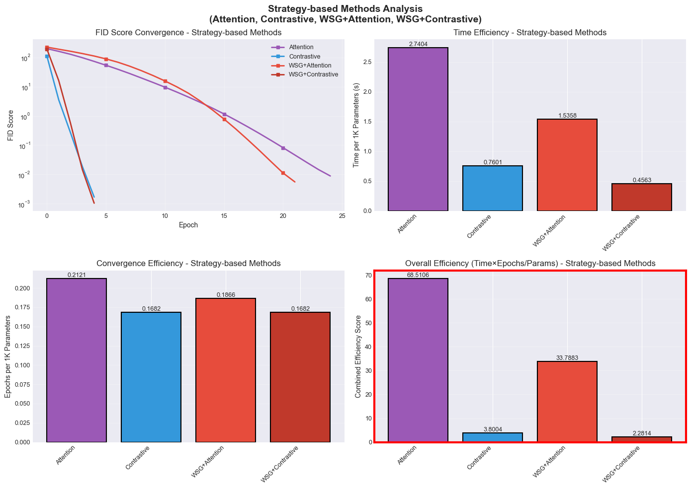

# 100% Multimodal Fusion

## Conclusion

WSG's fusion approach can eliminate redundant attention/extra learning on spatial information. In our micro-experiments, it achieves better performance than existing model-structure-based fusion methods (concatenation fusion, early input layer, middle encoder feature fusion, late latent space fusion) and existing training-strategy-based fusion methods (attention mechanism, contrastive learning).

If we define the capability upper limit of previous parameter-based methods as their respective 100%, our method can surpass this 100% fusion upper limit. At least in [micro-experiments](#experimental-results).

## Experimental Summary

First, we create four datasets: normal_input, normal_target, wsg_input, and wsg_target. We aim to train a model with **specific channel reversal capability**.

- normal_input consists of 300 256×256×1 npz files, divided into three parts, simulating channels 1, 2, 3, with values 1, 2, 3 respectively. For normal_target, channel 1's value changes from 1 to 3, channel 2's value remains 2, and channel 3's value changes from 3 to 1.
- wsg_input consists of 100 256×256×3 npz files, where each npz's channels 1, 2, 3 have values 1, 2, 3 respectively. wsg_target contains the reversed results, i.e., 3, 2, 1.

We then train models with reversal capability using conventional existing methods or training strategies.

The evaluation method stops training when FID < 0.01 and records various information. Evaluation metrics are:

1. **FID change over epochs** (faster decrease is better)
2. **Training completion time divided by parameters** (shorter is better, though some models need more epochs in the same time, parameter unit is 1k)
3. **Number of epochs at completion divided by parameters** (fewer is better, though some models take longer per epoch)
4. **Completion time × training epochs / parameters** (lower is better, this is our main metric as it's more reasonable than the previous two)

## Model Architecture

### Fusion at Model Structure Level

1. WSG Fusion - Data-level fusion
> Input: 3-channel fused image → UNet → Output: 3 channels  
> Feature: Directly processes pre-fused data, naturally preserves temporal-spatial correspondence

2. Early Fusion
> Input: 3 channels → [Concat] → UNet → Output: 3 channels  
> Feature: Merges at input layer, then processes uniformly

3. Middle Fusion
> Input1 → Encoder1 ↘  
> Input2 → Encoder2 → [Feature Fusion] → Decoder → Output  
> Input3 → Encoder3 ↗  
> Feature: Extracts features separately, fuses at middle layer

4. Late Fusion
> Input1 → Complete UNet1 → Output1 ↘  
> Input2 → Complete UNet2 → Output2 → [Concat] → Output  
> Input3 → Complete UNet3 → Output3 ↗  
> Feature: Processes independently until final merge

5. Concat Fusion - Concatenation strategy (channel mixing)
> Input: 3 channels → 1×1 convolution mixing → UNet → Output  
> Feature: Simple channel mixing followed by processing

Note: Our method is inherently compared against the other four.

### Training Strategy-based Fusion

1. Attention Fusion - Attention mechanism
> Input → Channel attention → Spatial attention → UNet → Output  
> Feature: Learns channel and spatial importance weights

2. Contrastive Fusion - Contrastive learning
> Input → Separation → 3 encoders → Projection to shared space → Fusion decoding  
> Feature: Similar to CLIP, learns correspondence between modalities

Note: For training strategy fusion, ablation evaluation is needed with both normal input and WSG input.

## Experimental Results

### Performance Visualization

*Figure 1: Comparison of stage-based fusion methods (WSG, Early, Middle, Late, Concat)*

*Figure 2: Comparison of strategy-based fusion methods (Attention, Contrastive, WSG+Attention, WSG+Contrastive)*

### Key Findings

- WSG methods consistently achieve better combined efficiency scores (lower is better)
- The red-bordered chart shows the overall efficiency metric: (Time × Epochs) / Per 1k Parameters
- WSG's pre-fusion approach should be eliminates redundant spatial information learning

### Additional Rough Estimate

Additionally, we recall that Overall Efficiency = (Training Time × Training Epochs) / Parameter Count × 1000
Then in the ablation evaluation, we know that:

- WSG-based average: 18.0348 - average of WSG+Attention and WSG+Contrastive 
- Traditional average: 36.1555 - average of Attention and Contrastive 
- Lower is better (completing training for the same parameter count with less time × epochs, parameter unit is 1k) 

Their loading times are not included, and parameters are normalized, with identical architectures. There may be some millisecond-level errors, but simply put:

WSG achieves a 100.5% improvement in training efficiency (improvement = ((36.1555 / 18.0348) - 1) × 100 = 100.5%), which means the efficiency is 2.005 times the original (All other conditions/setup are the same).

Code available at [this link](./100%25_multimodal_fusion.ipynb).